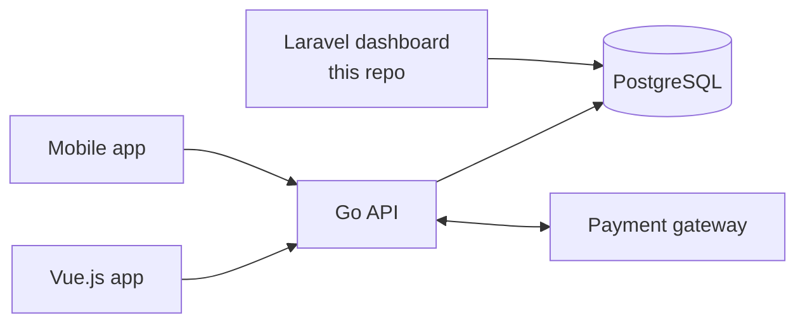
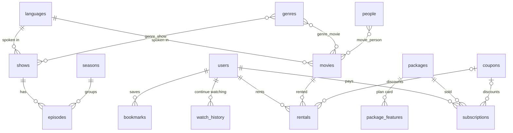

# Goflix dashboard demo

The admin dashboard of a video streaming platform I worked on. In production the platform has three parts:

- a **Vue.js** web app for viewers,
- a **Go** API that the apps call (sign-up, playback, payments),
- a **Laravel** dashboard where the team manages the catalog, plans and users,

all sharing one **PostgreSQL** database. My part was the dashboard, so this repo rebuilds only that, on the same
data model, with made-up data. The Go API and the Vue app are not here; they appear in the diagram below as the
other readers of the same tables.

Part of my portfolio: https://github.com/Enricosaputra/developer-portfolio

## What it does

- **Dashboard**: revenue per month (subscriptions and rentals), active subscribers, hours watched, most watched
  movies, popular genres, plans sold, how users sign in, subscriptions ending this week.
- **Content**: movies (genres, cast, free or premium, optional rent price) and series with episodes per season.
- **Master data**: genres, languages, cast and crew, season names.
- **Plans and payments**: subscription plans with their plan-card lines, coupons, subscriptions, rentals.
- **Users**: subscription status, payments, continue-watching list, and a "can this user watch it?" check.
- Bahasa Indonesia by default, English on request (ID / EN in the sidebar).

## The rules

They live in `app/Services` and are covered by feature tests.

| Rule | Where |
| --- | --- |
| Buying a plan while still subscribed adds the time after the current end date; after it lapsed it starts today | `SubscriptionService` |
| A coupon is a fixed amount or a percentage, only valid between its dates, never below zero, and a single-use coupon works once per user | `CouponService` |
| Only a premium movie with a rent price can be rented; subscribers cannot rent what they already have; the same movie cannot be rented twice at once | `RentalService` |
| Free plays for everyone; premium needs an active subscription, or an active rental of that movie; an episode is premium on its own or through its series; inactive accounts and titles play for nobody | `AccessService` (the rule the Go API enforces) |
| Payments are records: subscriptions and rentals are never edited or deleted | routes |
| Anything in use (a genre on a movie, a sold plan, a user with payments) cannot be deleted, only made inactive | models |

## Architecture



## Data model

Built from the production schema, trimmed to what the dashboard needs.



Differences from production, on purpose:

| Production | This demo |
| --- | --- |
| Genres, languages and cast on a video stored as comma-separated ids in text columns (`category_id = '6,12'`) | Pivot tables with foreign keys, so they can be joined, indexed and kept consistent |
| No foreign key constraints | Foreign keys with `restrictOnDelete` |
| Status flags as numbers (`status = 1`, `type = 4`) and `is_delete` | Booleans and string enums, real deletes guarded by the app |
| Video files per quality (320/480/720/1080), trailers, subtitles, downloads, games, music, radio, banners, home sections | Not included; the dashboard rules do not depend on them |
| `user.expiry_date` | `users.subscription_ends_on`, only ever moved by `SubscriptionService` |
| Watch position in milliseconds | Seconds |

## Run it

Needs Docker:

```bash
docker compose up --build
# http://localhost:8080 , sample data is created on start
```

Or with PHP 8.1+, Composer and Node, against a local PostgreSQL (see `.env.example`):

```bash
composer install && npm install && npm run build
cp .env.example .env && php artisan key:generate
php artisan migrate --seed
php artisan serve
```

Tests run on SQLite in memory: `php artisan test`.

## Online demo

The repo is private; the running app is public. It runs on Vercel's free plan as a PHP serverless function
(`vercel-php`) with a free Neon PostgreSQL database. Use Neon's **direct** connection string, not the `-pooler`
one: PgBouncer in transaction mode loses PDO's prepared statements. Environment variables are listed in
`deploy/vercel.env.example`. There is no login, so visitors can change data; the sample data is restored every
`DEMO_RESET_HOURS`, and an empty or outdated database is rebuilt on the first request.

## Laravel 10 and security advisories

This demo targets Laravel 10, which is end-of-life. `composer.json` ignores the advisories for `laravel/framework`
only. None of them reach this app: the debug page is off outside local, there are no signed URLs, and email
addresses are checked with a plain pattern instead of Laravel's `email` rule. A real deployment should upgrade.

## Slides

`docs/` has a walkthrough deck in Bahasa Indonesia (`Goflix-presentasi`) and English (`Goflix-walkthrough`),
each as `.pptx` and `.pdf`. The app also serves them from its root, e.g. `/goflix-walkthrough.pdf`.

## How it is organised

```
app/Enums/                 LoginType, PersonRole, AmountType
app/Services/              SubscriptionService, RentalService, CouponService, AccessService, DashboardStats
app/Http/Controllers/      thin resource controllers; NamedResourceController for name-only master data
app/Http/Requests/         validation per form
database/seeders/          made-up catalog, users and a year of payments
tests/Feature/             subscriptions, rentals and access, catalog, language, demo reset
```
